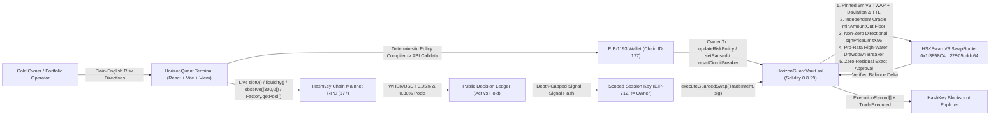

# HorizonQuant Agent

**Non-Custodial TWAP-Guarded Session-Key Trading Vault & Decision Ledger on HashKey Chain (`chainId 177`)**

Built for **DoraHacks HSK Chain Horizon Hackathon · Seoul — Track 1: AI Agent Trading**.

**Live Web Terminal (GitHub Pages)**: [https://alphonshhhomenicmtu.github.io/horizonquant-hsk/](https://alphonshhhomenicmtu.github.io/horizonquant-hsk/)

**Architecture & Security Audit Deck (PDF)**: [https://alphonshhhomenicmtu.github.io/horizonquant-hsk/horizonquant-deck.pdf](https://alphonshhhomenicmtu.github.io/horizonquant-hsk/horizonquant-deck.pdf) ([`docs/horizonquant-deck.pdf`](docs/horizonquant-deck.pdf))

HorizonQuant splits off-chain market monitoring and deterministic policy compilation from hard EVM risk enforcement inside `HorizonGuardVault.sol`. The owner keeps full cold custody of vault funds; the trading agent holds only a scoped EIP-712 session key that can never equal the owner, withdraw capital, bypass the on-chain TWAP slippage floor, or push past daily loss limits.

---

## System Architecture



---

## Live Verified HashKey Chain Mainnet (`177`) Pool Reality

Every contract address and pool was probed live against `https://mainnet.hsk.xyz` at block `30,589,426` (`500.001 gwei` base fee):

| Component | Mainnet Address (`chainId 177`) | Live RPC Probe Result |
|---|---|---|
| **HSKSwap V3 `SwapRouter`** | `0x1f3858C46F8F6fE76260b8208995D228C5cddc64` | Verified Uniswap V3 `SwapRouter` v1 ABI (`exactInputSingle` with `deadline`) |
| **HSKSwap V3 `Factory`** | `0xD136e36610f35E0Cc3cAd40de858c151f2AA65D4` | Live pool registry probed across `100 / 500 / 3000 / 10000` fee tiers |
| **`WHSK` (Wrapped HSK, 18 dec)** | `0xB210D2120d57b758EE163cFfb43e73728c471Cf1` | Primary traded asset |
| **`USDT` (Tether USD, 6 dec)** | `0xF1B50eD67A9e2CC94Ad3c477779E2d4cBfFf9029` | Vault quote currency & NAV base |
| **`WHSK/USDT` Pool (`0.05%`)** | `0xEB33d6666dd2359cB1BF6Ea6D72286Cc1b4a778A` | **LIVE** — Spot & 5m TWAP `$0.100013`, `L = 2,830,955,089,632`, `observe([300, 0])` verified |
| **`WHSK/USDT` Pool (`0.30%`)** | `0x0767F7b1af495D245EA00219cFB8B2Ed6EafAe62` | **LIVE** — Spot & 5m TWAP `$0.100193`, `L = 950,573,096,369` (`~18.0 bps` gross spread vs `35.0 bps` combined fee hurdle -> agent explicitly **HOLDS**) |
| **`WETH/USDT`, `WBTC/USDT`, `WHSK/WETH`** | `Factory.getPool(...) == address(0)` | **Excluded from vault allowlist** — token contracts exist on chain `177`, but no active HSKSwap V3 pools exist yet |
| **Deployer EOA (Funding Target)** | `0x57A46E4E5F538452E4D672EF9D48e3e90E10A81C` | Ready for 1-command broadcast once `~3-5 HSK` gas arrives |

---

## Pre-Deploy Security Hardening & Audit Verification

`HorizonGuardVault.sol` was audited with a full local white-box Web3 toolchain (**Foundry Unit + Fuzz + Stateful Invariant Fuzzing**, **Aderyn v0.6.8**, **Slither v0.11.6**, and **Gitleaks v8.30.1**):

1. **Protected TWAP Oracle & Authorized Keepers**: Replaced permissionless spot `slot0()` sync with `setOraclePool(...)` (owner-pinned canonical V3 pools only), `onlyOwnerOrKeeper` access control on `syncPriceFromV3Pool(address token)`, Uniswap V3 `observe([twapWindowSec, 0])` TWAP + `TickMath`, minimum active liquidity floor, spot-vs-TWAP flash-manipulation check, step-change deviation bound, and hard `maxStalenessSec` TTL (`OraclePriceStale`).
2. **Independent On-Chain Oracle Slippage Floor**: Never trusts agent-supplied `expectedAmountOut` or `minAmountOut` down to 1 wei. The vault independently computes `oracleFairOut` and `oracleMinOut` from the freshness-checked pinned TWAP oracle, reverts with `MinAmountOutBelowOracleFloor` if an intent undercuts that floor, measures realized slippage against the on-chain oracle quote, and passes a non-zero directional `sqrtPriceLimitX96` to `SwapRouter.exactInputSingle`.
3. **Pro-Rata High-Water NAV Scaling**: `deposit()` and `withdraw()` scale `dayStartNavE18` and `dayHighWaterNavE18` pro-rata (`baseline * navAfter / navBefore`, rounded up for safety) so inflows never dilute trading losses and withdrawals never falsely trip the drawdown circuit breaker. Pre-trade drawdown breaches revert immediately (`DailyDrawdownExceeded`); post-trade breaches and `checkAndTripCircuitBreaker()` persistently latch `circuitBreakerTripped` until owner reset.
4. **Cold-Owner / Hot-Session Separation, Read-Only Reentrancy Guard & Hard Policy Floors**: Enforces `agent != owner` (`AgentCannotBeOwner`), `minTradeIntervalSec >= 10` seconds (`MIN_TRADE_INTERVAL_SEC`), signed `intent.deadline <= block.timestamp + 15 minutes` (`IntentDeadlineTooFar`), low-`s` EIP-712 recovery, monotonic nonces, zero-residual router allowances, full `nonReentrant` plus read-only reentrancy guards on `computeTotalNavE18()` / `currentDailyDrawdownBps()`, permanent quote-token valuation pinning (`registerToken` cannot override `quoteToken`), `slot0()` pool initialization / tick-bound checks, and `rescueNative()` for forced native HSK recovery.
5. **Static Analysis, Invariant & Quant Risk-Engine Verification**:
   - **Foundry (`forge test -vv`)**: `40/40` tests passing (upgraded from `28/28`) — `32` unit & adversarial red-team regression tests, `7` stateless fuzz tests (`1,792` runs, including 512-bit `_mulDiv` Newton-Raphson parity and pro-rata drawdown scaling), and `8` **stateful invariants** across `256` runs × `32` depth (`8,192` multi-actor calls with `0` reverts and `0` violations).
   - **Runtime Bytecode Size**: `20,454` bytes (`4,122` bytes below the `24,576`-byte EIP-170 limit; `21,717` bytes initcode).
   - **Chain 177 Fork Dry-Run (`DeployHorizonGuard.s.sol`)**: Simulated all 12 mainnet deploy + oracle configuration transactions against HashKey Chain Mainnet (`177`) with `5,876,290` gas (`~2.94 HSK` @ `500.001 gwei`, or `~2.73 HSK` once pool cardinality >= 16; `~3–5 HSK` recommended).
   - **Slither v0.11.6**: `0` High / `0` Medium findings (`0` results on `HorizonGuardVault.sol` after replacing bitwise XOR in `_mulDiv`, removing strict zero equalities, validating all `slot0()` returns, adding read-only reentrancy guards on NAV/drawdown views, and documenting canonical FullMath/TickMath/CEI balance-delta annotations).
   - **Aderyn v0.6.8**: `0` exploitable High/Medium findings (`nonReentrant` + read-only reentrancy guarded balance-delta accounting).
   - **TypeScript Quant & Risk-Engine (`npm test` / Vitest)**: `44/44` tests passing across `8` files (upgraded from `19/19`), including `21` adversarial tests covering `NaN`/`Infinity`/zero-volume candles, zero-liquidity pools, flash-crash drawdown spikes, wrong-chain/offline RPC fallback, deterministic floor order-sizing, bidirectional `WHSK`/`USDT` sizing caps, and full circuit-breaker trip-to-reset recovery.
   - **Gitleaks v8.30.1**: `0` secrets leaked across git history.

---

## Key Terminal Features

- **Public Agent Decision Ledger (Act vs Hold)**: Every RPC poll from `https://mainnet.hsk.xyz` appends a timestamped decision record showing live `0.05%` vs `0.30%` pool prices, 5-minute TWAP divergence, gross spread vs `35 bps` fee hurdle, 2% active liquidity depth, and exact numeric rationale for acting or holding.
- **Interactive Adversarial Breaker Lab**: One-click exploit buttons (`1-Wei Slippage`, `Stale Oracle`, `Unauthorized Keeper / Fake Pool`, `+25% Spot Flash Spike`, `Oversized Position`) that display exact malicious ABI calldata, the 4-byte Solidity custom error selector, and run live `eth_call` verification when attached to a deployed vault.
- **Real Wallet Execution + Live Vault Inspector**: Connect MetaMask / Rabby on `chainId 177` and attach any deployed vault (`?vault=0x...`) to read real balances, `policy()`, `session()`, and `ExecutionRecord[]`, sign real EIP-712 `TradeIntent` payloads, and broadcast transactions directly to HashKey Chain Mainnet. Pre-deploy local actions are explicitly marked `PAPER FILL`.
- **Illustrative Stress Scenario Model**: Clearly labeled 30-day synthetic stress scenario comparing tail-risk drawdown and adverse slippage protection with vs without `HorizonGuardVault` (no synthetic historical Sharpe claims). Demo subtitles in `demo-video/horizonquant-demo.srt` match the suite above: **40/40 Foundry** and **44/44 Vitest** across `8` files, with no NAV or Sharpe track record.

---

## Quick Start & Verification

### 1. Foundry Unit, Fuzz & Stateful Invariant Tests

```bash
cd contracts
forge build --sizes
forge test -vv
```

### 2. TypeScript Agent Tests, Typecheck & Production Web Build

```bash
npm install
npm test
npm run typecheck
npm run build
```

### 3. Run Locally

```bash
# Static terminal UI (direct browser RPC to HashKey Chain Mainnet 177)
npm run dev:web

# Optional Node API & telemetry server (http://127.0.0.1:8787)
npm run dev:api
```

### 4. One-Command HashKey Chain Mainnet (`177`) Deployment

Once `~3-5 HSK` lands on `0x57A46E4E5F538452E4D672EF9D48e3e90E10A81C`:

```bash
# 1. Verify live RPC, bytecode size, and deployer balance (no private key needed)
npm run deploy:mainnet -- --dry-run

# 2. Deploy HorizonGuardVault, expand pool TWAP cardinality, pin 0.05% oracle,
#    authorize keeper, sync initial TWAP, and configure distinct session key ($1,000 cap)
DEPLOYER_PRIVATE_KEY=0x<OWNER_PK> AGENT_ADDRESS=0x<DISTINCT_SESSION_KEY> npm run deploy:mainnet
```

The script writes deployed addresses and transaction hashes to `deployments/mainnet-177.json` and prints the exact `forge verify-contract` command for `https://hsk.blockscout.com` plus the direct `?vault=<address>` terminal URL.

---

## License

MIT
