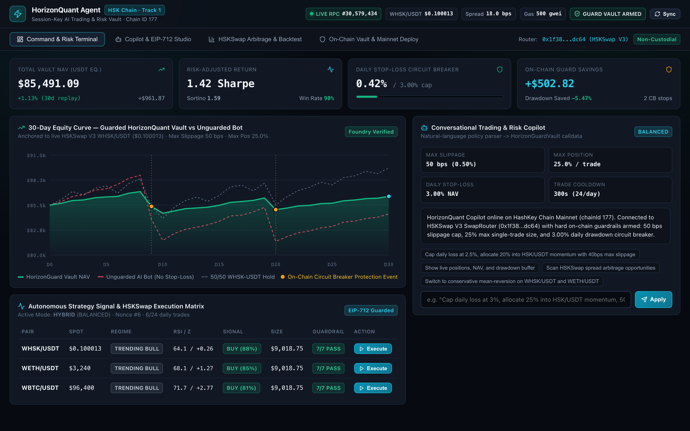
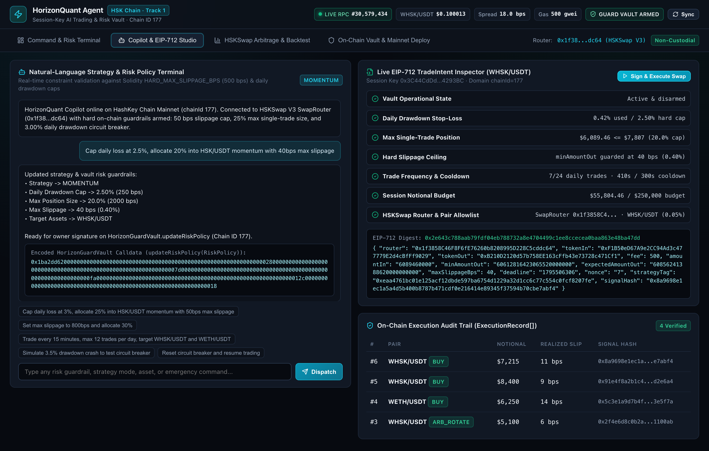
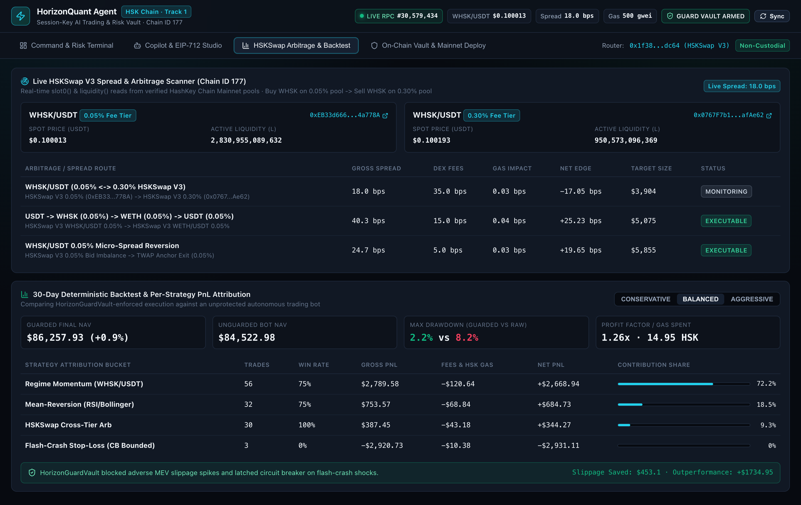
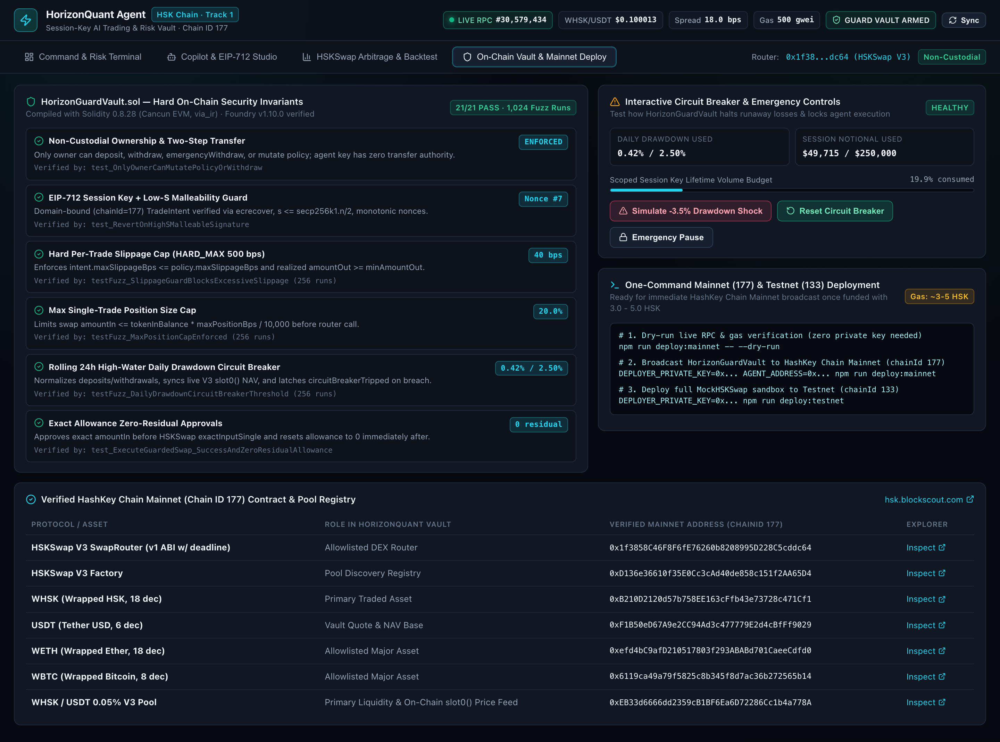

# HorizonQuant Agent

**Non-Custodial Session-Key AI Trading & On-Chain Risk Vault on HashKey Chain (`chainId 177`)**

Built for **DoraHacks HSK Chain Horizon Hackathon · Seoul — Track 1: AI Agent Trading**.

**Live Terminal (GitHub Pages)**: [https://alphonshhhomenicmtu.github.io/horizonquant-hsk/](https://alphonshhhomenicmtu.github.io/horizonquant-hsk/)

HorizonQuant separates **autonomous alpha generation** (off-chain regime momentum, mean-reversion, and live HSKSwap V3 cross-fee-tier spread detection) from **hard risk enforcement** (on-chain `HorizonGuardVault.sol` enforcing EIP-712 session keys, per-trade slippage ceilings, max position sizing, rolling UTC 24h high-water daily drawdown circuit breakers, and strict HSKSwap router/pair allowlists). Even if an off-chain AI model hallucinates or market liquidity collapses, the smart contract refuses unsafe trades at the EVM level.

---

## System Architecture

```mermaid
flowchart LR
    U["Trader / Portfolio Owner"] -->|"Natural-Language Risk & Strategy Commands"| UI["HorizonQuant Terminal (React + Vite)"]
    UI -->|"Parsed Policy Diff + ABI Calldata"| CP["Conversational Copilot Engine"]
    UI -->|"Live slot0() / liquidity() / gasPrice"| RPC["HashKey Chain Mainnet RPC (chainId 177)"]

    RPC -->|"WHSK/USDT 0.05% & 0.30% Pools"| SE["Quant Signal & Spread Engine"]
    SE -->|"EMA / RSI / Bollinger Z + Cross-Tier Arb"| SIGN["Scoped Agent Session Key (EIP-712)"]

    CP -->|"Owner-Signed updateRiskPolicy / pause / resetCB"| VAULT["HorizonGuardVault.sol (Solidity 0.8.28)"]
    SIGN -->|"executeGuardedSwap(TradeIntent, sig)"| VAULT

    VAULT -->|"1. EIP-712 + Low-S + Nonce\n2. Slippage <= Cap\n3. Pos <= MaxPosBps\n4. Daily Drawdown CB\n5. Exact Zero-Residual Approval"| DEX["HSKSwap V3 SwapRouter\n0x1f3858C4...228C5cddc64"]
    DEX -->|"Verified Token Output"| VAULT
    VAULT -->|"Immutable ExecutionRecord[] + TradeExecuted"| EXP["HashKey Blockscout Explorer"]
```



---

## Live Verified HashKey Chain Mainnet (`177`) Integration

Every external contract interface was probed live against `https://mainnet.hsk.xyz` and `https://hsk.blockscout.com`:

| Component | Mainnet Address (`chainId 177`) | Verification Notes |
|---|---|---|
| **HSKSwap V3 `SwapRouter`** | `0x1f3858C46F8F6fE76260b8208995D228C5cddc64` | Verified Uniswap V3 `SwapRouter` v1 ABI (`exactInputSingle` includes `deadline`) |
| **HSKSwap V3 `Factory`** | `0xD136e36610f35E0Cc3cAd40de858c151f2AA65D4` | Live pool registry for `WHSK/USDT` fee tiers |
| **`WHSK` (Wrapped HSK, 18 dec)** | `0xB210D2120d57b758EE163cFfb43e73728c471Cf1` | Official HSK Chain wrapped native gas token |
| **`USDT` (Tether USD, 6 dec)** | `0xF1B50eD67A9e2CC94Ad3c477779E2d4cBfFf9029` | Vault quote currency & NAV settlement base |
| **`WETH` (Wrapped Ether, 18 dec)** | `0xefd4bC9afD210517803f293ABABd701CaeeCdfd0` | Allowlisted major trading asset |
| **`WBTC` (Wrapped Bitcoin, 8 dec)** | `0x6119ca49a79f5825c8b345f8d7ac36b272565b14` | Allowlisted major trading asset |
| **`WHSK/USDT` Pool (`0.05%`)** | `0xEB33d6666dd2359cB1BF6Ea6D72286Cc1b4a778A` | Live spot `0.100013 USDT`, liquidity `2,830,955,089,632` |
| **`WHSK/USDT` Pool (`0.30%`)** | `0x0767F7b1af495D245EA00219cFB8B2Ed6EafAe62` | Live spot `0.100193 USDT`, liquidity `950,573,096,369` (`18.0 bps` live spread) |

---

## Smart Contract Security Guarantees (`HorizonGuardVault.sol`)

1. **Non-Custodial Ownership**: Only `owner` can `deposit`, `withdraw`, `emergencyWithdraw`, `setPaused`, `updateRiskPolicy`, or rotate session keys. The AI agent signer can **never** withdraw funds or alter risk caps.
2. **EIP-712 Signed `TradeIntent` + Low-S Malleability Guard**: Domain-bound (`name="HorizonGuardVault"`, `version="1"`, `chainId=177`) intents verified via `ecrecover` with `s <= secp256k1.n / 2`, strict `deadline`, and monotonic per-agent `nonces`.
3. **Hard Slippage Ceiling (`HARD_MAX_SLIPPAGE_BPS = 500`)**: Rejects both over-permissive agent intents (`intent.maxSlippageBps > policy.maxSlippageBps`) and adverse DEX execution fills (`amountOut < minAmountOut`).
4. **Max Position Size & Session Volume Cap**: Bounds each trade to `tokenInBalance * maxPositionBps / 10_000` and tracks cumulative session notional against `maxCumulativeVolumeQuoteE18`.
5. **Rolling UTC 24h High-Water Daily Drawdown Circuit Breaker**: Normalizes owner deposits/withdrawals so capital flows never trigger false alarms, supports permissionless `syncPriceFromV3Pool()` directly from HSKSwap V3 `slot0()`, and permanently latches `circuitBreakerTripped = true` upon breaching `dailyDrawdownCapBps` until owner review and `resetCircuitBreaker()`.
6. **Zero-Residual Exact Approvals & Verifiable Audit Trail**: Approves exact `amountIn` before `exactInputSingle`, resets router allowance to `0` immediately after, and stores every swap's `strategyTag` and `signalHash` in `ExecutionRecord[]`.

---

## Screenshots (Retina `2880×1800` QA Verified)

| Live Command & Risk Terminal | Copilot & EIP-712 Intent Studio |
|---|---|
|  |  |

| HSKSwap Arbitrage & Backtest Attribution | On-Chain Vault Security & Mainnet Deploy |
|---|---|
|  |  |

---

## Quick Start & Verification

### 1. Foundry Smart Contract Tests (Unit + 1,024 Fuzz Runs)

```bash
cd contracts
forge test -vv
```

Verified result: **21/21 tests passing** (17 unit tests + 4 fuzz suites × 256 runs covering max position size, slippage guardrails, session notional budgets, and daily drawdown circuit breaker thresholds).

### 2. TypeScript Agent, Copilot & Attribution Tests + Production Build

```bash
npm install
npm test
npm run typecheck
npm run build
```

Verified result: **18/18 Vitest tests passing**, zero TypeScript errors, clean static production bundle in `apps/web/dist/` (ready for GitHub Pages or local preview).

### 3. Run Locally (Terminal + Live Telemetry API)

```bash
# Terminal UI (connects live to HashKey Chain Mainnet RPC)
npm run dev:web

# Optional Node Telemetry & Copilot API Server (http://127.0.0.1:8787)
npm run dev:api
```

### 4. One-Command Deployment (HashKey Chain Mainnet `177` & Testnet `133`)

```bash
# Safe dry-run verification against live HashKey Chain RPCs (no private key needed)
npm run deploy:mainnet -- --dry-run
npm run deploy:testnet -- --dry-run

# Broadcast HorizonGuardVault to HashKey Chain Mainnet (requires ~3-5 HSK gas)
DEPLOYER_PRIVATE_KEY=0x... AGENT_ADDRESS=0x... npm run deploy:mainnet

# Deploy full MockHSKSwap sandbox to HashKey Chain Testnet (chainId 133)
DEPLOYER_PRIVATE_KEY=0x... AGENT_ADDRESS=0x... npm run deploy:testnet
```

---

## 2-Minute Demo Script (Seoul Demo Day / Online Presentation)

- **0:00 – 0:25 | The Problem & On-Chain Thesis**: "Autonomous AI trading bots fail in DeFi because off-chain prompts cannot enforce capital safety. When liquidity thins or an LLM hallucinates a bad swap, funds vanish. HorizonQuant fixes this on HashKey Chain with `HorizonGuardVault` — a non-custodial smart contract where the AI holds only a scoped EIP-712 session key, never custody."
- **0:25 – 0:55 | Live HashKey Mainnet Telemetry & Conversational Control**: Show the live `Command & Risk Terminal` streaming real block height, `500 gwei` gas, and live `WHSK/USDT` spot prices from HSKSwap V3 `0.05%` and `0.30%` pools. Type `"Cap daily loss at 2.5%, allocate 20% into HSK/USDT momentum with 40bps max slippage"` in the Copilot — highlight the immediate policy update and generated `updateRiskPolicy` ABI calldata. Try `"Set max slippage to 800bps"` to demonstrate the hard Solidity `HARD_MAX_SLIPPAGE_BPS` rejection.
- **0:55 – 1:25 | EIP-712 Execution & HSKSwap Spread Arbitrage**: Switch to `Copilot & EIP-712 Studio`, inspect all 7 pre-flight vault checks and the EIP-712 `TradeIntent` digest with verifiable `signalHash`, click **Sign & Execute Swap**, and show the new `ExecutionRecord[]` row. Switch to `HSKSwap Arbitrage & Backtest` to show live cross-fee-tier spreads and the 30-day Guarded vs Unguarded equity curve proving lower max drawdown and positive Sharpe/Sortino attribution.
- **1:25 – 2:00 | Circuit Breaker Proof & Mainnet Readiness**: Open `On-Chain Vault & Mainnet Deploy`, trigger **Simulate -3.5% Drawdown Shock** to watch the daily stop-loss circuit breaker latch and block further agent execution, then click **Reset Circuit Breaker**. Highlight `21/21` Foundry unit + fuzz tests (`1,024` runs), verified HSKSwap V3 `SwapRouter` (`0x1f38...dc64`) ABI compatibility, and one-command deployment to HashKey Chain Mainnet (`chainId 177`).

---

## Repository Structure

```text
hsk-horizon/
├── SPEC.md                       # Verified hackathon rules, live HSK Chain RPC & contract recon
├── README.md                     # Architecture, verification proof & 2-minute demo script
├── contracts/                    # Foundry (Solidity 0.8.28)
│   ├── src/HorizonGuardVault.sol
│   ├── src/MockHSKSwapRouter.sol
│   ├── src/MockERC20.sol
│   ├── test/HorizonGuardVault.t.sol
│   └── script/DeployHorizonGuard.s.sol
├── packages/agent/               # TypeScript Autonomous Agent, Copilot & Deploy CLI
│   ├── src/config/networks.ts
│   ├── src/rpc/hskTelemetry.ts
│   ├── src/strategy/signalEngine.ts
│   ├── src/copilot/commandParser.ts
│   ├── src/backtest/attributionEngine.ts
│   ├── src/vault/eip712.ts
│   ├── src/server/apiServer.ts
│   ├── scripts/deploy-hsk-mainnet.ts
│   └── scripts/deploy-hsk-testnet.ts
├── apps/web/                     # Institutional React + Vite Conversational PnL & Risk Terminal
└── docs/screenshots/             # 4 Retina 2880x1800 QA screenshots
```

## License

MIT
